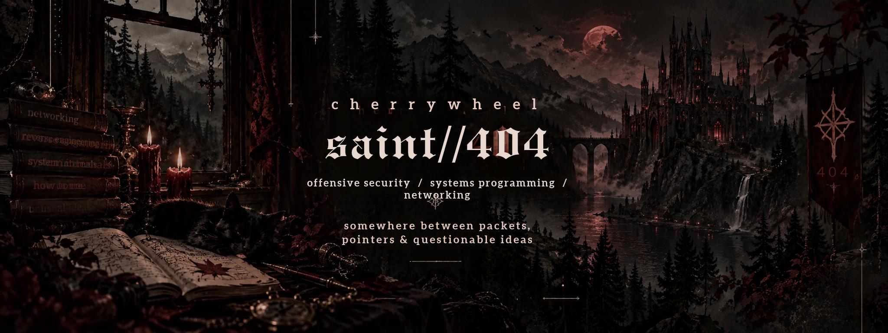
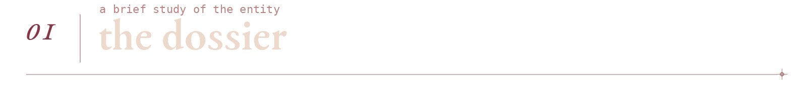
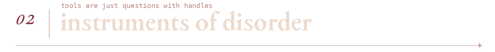
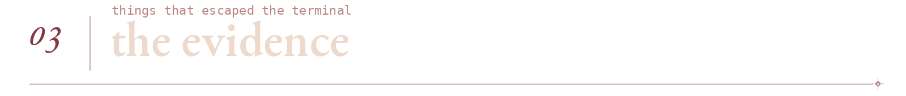
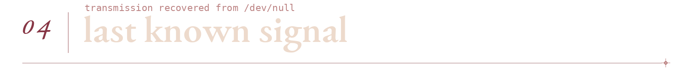

<p align="center">
  
</p>

<p align="center">
  
</p>

<div align="center">

`red team` &nbsp; ✦ &nbsp; `systems programming` &nbsp; ✦ &nbsp; `network engineering`

</div>

<br>



> i like my software understandable, my protocols documented and my bugs deeply inconvenient

somewhere between packet captures and a debugger at 3 am, i got a little too interested in the things software was never supposed to do

i write code, study failure modes and follow the interesting bits all the way down to the metal

**the short version:** offensive security, low-level programming, networks and an unreasonable amount of curiosity

<pre>
  alias       cherrywheel
  role        red team / software engineer
  habitat     linux terminals and packet captures
  status      404: acceptable assumptions not found
</pre>



| field | toolkit |
| :--- | :--- |
| **languages** | `c` &nbsp; `c++` &nbsp; `python` &nbsp; `erlang` |
| **environment** | `linux` &nbsp; `shell` &nbsp; `git` |
| **networking** | `tcp/ip` &nbsp; `routing` &nbsp; `wireguard` |
| **automation** | `ansible` |
| **obsessions** | `red teaming` &nbsp; `reverse engineering` &nbsp; `protocol internals` |

<sub>not a stack of badges, just the instruments currently on the workbench</sub>



<table>
<tr>
<td width="50%" valign="top">
<sub>01 / NETWORK TOOLING</sub>
<h3><a href="https://github.com/cherrywheel/speedtest">speedtest++</a></h3>
<p>a c++ speed test client with multiple backends, result history and output made for both humans and scripts</p>
<sub><code>c++</code> · <code>networking</code></sub>
</td>
<td width="50%" valign="top">
<sub>02 / CROSS-PLATFORM CHAOS</sub>
<h3><a href="https://github.com/cherrywheel/CN-Tower-C">cn tower</a></h3>
<p>a text adventure rewritten in c and built for a frankly unnecessary number of architectures</p>
<sub><code>c</code> · <code>systems</code></sub>
</td>
</tr>
<tr>
<td colspan="2" valign="top">
<sub>03 / INFRASTRUCTURE EXPERIMENTS</sub>
<h3><a href="https://github.com/cherrywheel/Example-Ansible-Cisco-IX-17">cisco ios xe automation</a></h3>
<p>an ansible example for network device configuration and ios xe workflows, experimental by design and not intended for production use</p>
<sub><code>ansible</code> · <code>network automation</code></sub>
</td>
</tr>
</table>



```console
$ whoami
cherrywheel

$ cat /etc/motd
curiosity is not a vulnerability
but it makes finding them easier

$ inspect --assumptions
0 trusted, 17 pending review

$ exit
permission denied: unfinished business
```

<details>
<summary>classified / open at your own risk</summary>

<br>

the cat has seen the stack trace and refuses to testify

</details>

<br>

<p align="center">
  
</p>
